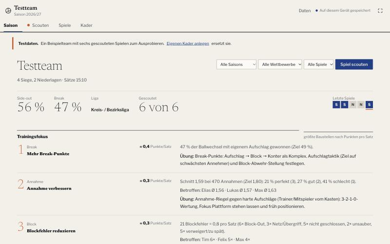
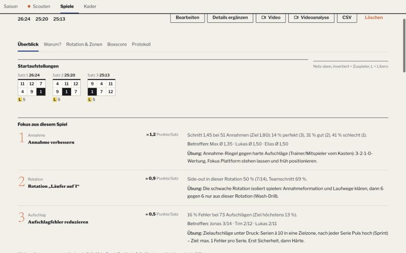
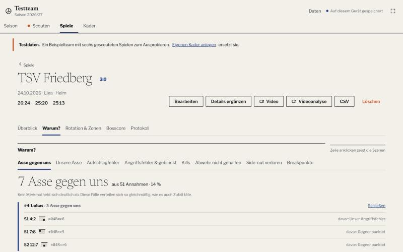

# Volleyball Scouting

Web-App, mit der ein Volleyballteam seine Spiele aus dem Video scoutet und versteht, **warum** Punkte verloren gehen. Ein Beispiel: Gegen wen kassieren wir die Asse, in welcher Rotation, bei welchem Spielstand und nach welchem Ballwechsel davor?

Ein Lernprojekt, das ich für mein eigenes Team gebaut habe. Es läuft komplett im Browser, ohne Server, Konto oder Installation.



## Was die App kann

- **Scouten aus dem Video oder live in der Halle:** Aktionen per Tippen, Kurzcode oder Sprache, mit Spielstand, Rotation und Aufstellung.
- **Automatischer Ballwechsel-Schnitt:** Die App hört die Pfiffe im Video und misst die Bewegung auf dem Spielfeld. So springt sie beim Scouten über die Pausen.
- **„Warum?“-Analyse:** Jede Kennzahl, etwa Asse gegen uns, Angriffsfehler oder verlorene Side-outs, lässt sich nach Spieler, Zone, Rotation, Spielphase, Spielstand und Vorgeschichte aufschlüsseln. Gemeldet werden nur Unterschiede, die über Zufall hinausgehen. Jede Zeile führt zu den einzelnen Szenen.
- **Videoanalyse:** Das Video und eine durchsuchbare Liste aller Ballwechsel stehen nebeneinander, etwa mit der Suche „#7 Kill“ oder „20:18“. Ein Klick springt an die Stelle.
- **Spielbericht wie im Verein üblich:** Startaufstellungen mit Trikotnummern, Rotationen, Boxscore, Zonen und Angriffsrichtungen.
- **Trainingsfokus:** Die größten Baustellen der Saison, gemessen in Punkten pro Satz, jeweils mit einer passenden Übung.





## Ausprobieren

```bash
git clone https://github.com/lennardkotz-star/volleyball-scouting.git
cd volleyball-scouting
python3 -m http.server 8377
```

Dann http://localhost:8377 öffnen, am besten in Chrome oder Edge.

Beim ersten Start sind **Testdaten** geladen: ein Team mit zehn Spielern und sechs gescouteten Spielen, alle Namen erfunden. Damit lässt sich jede Ansicht sofort durchklicken. „Eigenen Kader anlegen“ ersetzt die Testdaten, und unter Daten lassen sie sich jederzeit wieder laden. Videos sind nicht dabei. Für die Videoanalyse braucht es eine eigene Spielaufnahme.

## Technik

- **Ohne Framework:** HTML, CSS und JavaScript ohne Build-Schritt, rund 5.500 Zeilen.
- **Speicher im Browser:** Die Daten liegen in IndexedDB, Videos verlassen das Gerät nie.
- **Ballwechsel-Schnitt im Browser:** Web Audio API (Frequenzanalyse der Pfiffe), Canvas (Bewegung im Spielfeld-Ausschnitt) und eine Viterbi-Zuordnung, die Pfiffe und Bewegung zu Ballwechseln verbindet.
- **Statistik:** Vergleich zweier Anteile mit Signifikanztest. So meldet die „Warum?“-Analyse keine Zufallsmuster.
- **Offline-fähig als Progressive Web App:** Schriften und Dateien liegen lokal.
- **Design:** Gestaltet wie der Sportteil einer Zeitung, mit Newsreader, Libre Franklin und IBM Plex Mono, einer Hauptfarbe, einem Akzent und einem 8-px-Raster.

| Datei | Inhalt |
| --- | --- |
| `js/core.js` | Spielablauf, Regeln, Statistik, Zusammenhänge, Sprach- und Textparser |
| `js/app.js` | Oberfläche: Saison, Scouten, Spiele, Kader, Daten, Speicher |
| `js/rally.js` | Ballwechsel-Schnitt aus Pfiffen und Bewegung |
| `js/video.js` | Video-Player, Sprünge über die Pausen, Korrekturen |
| `js/why.js` | „Warum?“-Analyse und Rotationstabellen |
| `js/workspace.js` | Videoanalyse mit durchsuchbarer Ballwechsel-Liste |
| `js/zones.js` | Zonen erfassen und auswerten |
| `js/kader.js` | Kader anlegen und Testdaten |
| `js/share.js` | Spielerkarte und Trainer-Ansicht als Link |
| `css/editorial.css` | Erscheinungsbild |

## Tests

`tests/unit.html` im Browser öffnen, während der Server läuft. Die 39 Tests prüfen Spiellogik, Parser, die „Warum?“-Analyse und den Ballwechsel-Schnitt an simulierten Spielen mit bekannter Lösung.

**Ehrlicher Stand:** Den Schnitt habe ich bisher nur an simulierten Daten und einem künstlichen Video geprüft, noch nicht an echten Hallenaufnahmen. Getestet ist die App in Chrome, Safari und echte iPhones noch nicht.

## Wie die App entstanden ist

Programmiert habe ich die App zusammen mit Claude, einer KI von Anthropic. Von mir kommen die Idee, das Volleyball-Fachwissen, die Anforderungen und die Entscheidungen, was die App können soll und wie sie aussieht. Ich habe sie außerdem durchgetestet und Feedback gegeben. Mir ging es darum zu lernen, wie aus einer Idee ein funktionierendes Produkt wird: Recherche, Informationsarchitektur, Design, Umsetzung und Veröffentlichung.

In `docs/recherche/` liegen die Designrecherchen, auf denen das Erscheinungsbild beruht.

## Lizenzen

Die Schriften Newsreader, Libre Franklin und IBM Plex Mono stehen unter der SIL Open Font License, die Lizenztexte liegen in `fonts/`.
